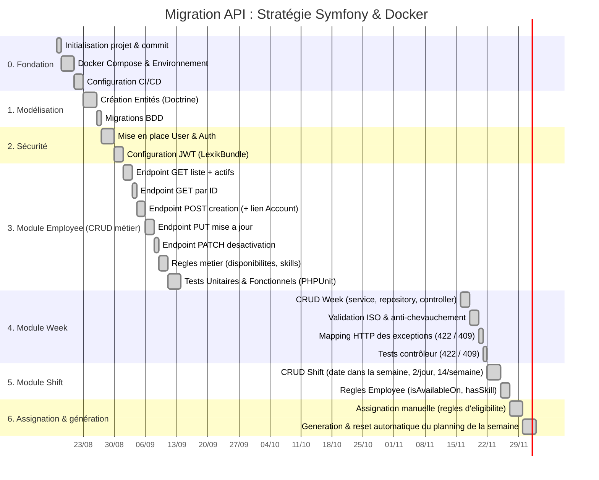

# Plan de Migration et Gestion de Projet : API TypeScript vers Symfony

Ce document détaille le planning et la méthodologie suivis pour la refonte de l'API [gensceduleback](https://gitlab.com/remyHamed/gensceduleback), initialement écrite en TypeScript, vers une architecture Symfony 8.1 / PHP 8.4.

> **Périmètre** : ce planning couvre la migration à parité de fonctionnalités avec l'API TypeScript existante (Auth + module Employee) ainsi que l'implémentation complète des modules `Week`, `Shift`, assignation manuelle et génération/réinitialisation automatique du planning (Phases 4 à 6).

## 1. Diagramme de Gantt (Planning prévisionnel)

## 2. Roadmap et Découpage des Tâches

Chaque étape ci-dessous correspond à une branche ou une issue sur le dépôt.

### Phase 0 : Infrastructure (Fondations)

- [x] Initialisation du projet Symfony et premier commit sur GitLab.
- [x] Dockerisation : mise en place de php-fpm, nginx, postgresql via docker-compose (Dockerfile multi-stage dev/prod, healthchecks, séparation des secrets).
- [x] CI/CD : configuration du pipeline pour le linting et les tests automatiques.

### Phase 1 : Modélisation (ORM)

- [x] Entités : modélisation des données de l'API TS (`Account`, `Employee`, `Week`, `Shift`).
  - Note : le champ des disponibilités est nommé `availableSlots`.
- [x] Migrations : génération et exécution des fichiers de migration Doctrine.

### Phase 2 : Sécurité & Authentification

- [x] UserProvider : configuration de l'entité `User` (`Account`) pour l'auth Symfony.
- [x] JWT : installation et configuration de `lexik/jwt-authentication-bundle` pour sécuriser les endpoints.
- [x] Endpoints `/auth/register` et `/auth/login` (portage direct de `AuthController` / `AuthService`).

> **Note de périmètre** : l'API source ne définit aucun CRUD complet pour `Account` (pas de liste, mise à jour, ni suppression — uniquement `register`, `login` et les lookups internes par `id`/`email`). Ce planning ne couvre donc que l'authentification.

### Phase 3 : Implémentation Métier — Module `Employee`

Reprend fidèlement les endpoints exposés par `EmployeeController` dans l'API TypeScript source.

- [x] `GET /api/employees` : liste complète des employés.
- [x] `GET /api/employees/active` : liste filtrée sur `isActive = true`.
- [x] `GET /api/employees/{id}` : détail d'un employé (404 si absent).
- [x] `POST /api/employees` : création, avec liaison obligatoire à un `Account` existant (`accountId`) et vérification qu'un `Account` n'est pas déjà lié à un employé.
- [x] `PUT /api/employees/{id}` : mise à jour partielle (nom, `weeklyHours`, `availableSlots`, `excludedDates`, `skills`).
- [x] `PATCH /api/employees/{id}/deactivate` : désactivation (soft delete via `isActive`).
- [x] Portage des enums `Role` (`ADMIN`, `EMPLOYEE`, `MANAGER`) et `DayOfWeek` (`0-6`) en PHP (enums natifs PHP 8.4).
- [x] Règles métier : disponibilité d'un employé sur une date/créneau donné (`isAvailableOn`) et matching par compétences (`hasSkill`).
- [x] `DELETE /api/employees/{id}` : suppression définitive (`EmployeeInUseException` si l'employé est référencé).
- [x] Tests PHPUnit : couverture complète unitaire et fonctionnelle (cas nominaux et erreurs 404 / 409 / 422).

### Phase 4 : Module `Week`

Règles métier : une semaine dure 7 jours, `startDate` est le lundi ISO-8601 de `(year, weekNumber)`, un seul établissement et une seule équipe.

- [x] CRUD `Week` : `GET /api/weeks`, `GET /api/weeks/{id}`, `POST`, `PUT`, `DELETE`.
- [x] Unicité du couple `(year, weekNumber)` (create et update, en excluant l'id courant sur update).
- [x] Validation de la période : format `Y-m-d`, `startDate` = lundi, `weekNumber` entre 1 et 53, semaine existante cette année-là, cohérence `year` / `weekNumber` / `startDate`.
- [x] Interdiction de chevauchement (`WeekRepository::overlapsPeriod`), les semaines consécutives restent autorisées.
- [x] Exceptions métier : `InvalidWeekPeriodException` (422), `WeekOverlapException` (409), `WeekAlreadyExistsException` (409).
- [x] Tests unitaires du service (`WeekServiceTest`) et tests contrôleur (`WeekControllerTest`).
- [x] Gestion de l'impact `Week` / `Shift` lors de la modification ou suppression d'une `Week` contenant des shifts.

### Phase 5 : Module `Shift`

Règles métier : un `Shift` est rattaché à une `Week` immuable (date comprise entre `startDate` et `startDate + 6 jours`), `endTime` strictement après `startTime`, aucun chevauchement horaire sur une même journée, 2 shifts max par jour, 14 max par `Week`, modification libre de `skillsRequired`, suppression directe autorisée (nettoyage de la liaison `shift_employee`).

- [x] `GET /api/shifts` : liste complète et filtrage par semaine (`?weekId=...`).
- [x] `GET /api/shifts/{id}` : détail d'un shift (200 / 404).
- [x] `POST /api/shifts` : création avec validations de période, horaires, anti-chevauchement et quotas (2/jour, 14/semaine).
- [x] `PUT /api/shifts/{id}` : mise à jour avec revalidation des règles métier.
- [x] `DELETE /api/shifts/{id}` : suppression (204 / 404).
- [x] Tests unitaires (`ShiftServiceTest`) et fonctionnels (`ShiftControllerTest`) complets.

### Phase 6 : Assignation et génération du planning

Portage et enrichissement de `SchedulingService` et des stratégies d'attribution.

- [x] Règles d'éligibilité granulaires (employé actif, compétence requise, disponibilité sur le créneau, plafond `weeklyHours`, non-chevauchement/non-doublon) et suivi des heures (`AssignedHoursTracker`).
- [x] `GET /api/shifts/{id}/eligible-employees` : liste des employés éligibles pour un shift donné.
- [x] `POST /api/shifts/{id}/assign` : assignation manuelle avec validation des règles d'éligibilité.
- [x] `DELETE /api/shifts/{id}/assign/{employeeId}` : désassignation d'un employé sur un shift.
- [x] `POST /api/weeks/{id}/generate-schedule` : génération automatique du planning de la semaine (priorité week-end + stratégie `LeastHoursFirstStrategy`) avec retour des shifts triés.
- [x] `DELETE /api/weeks/{id}/schedule` : réinitialisation complète des assignations de la semaine avec retour des shifts mis à jour.
- [x] Tests unitaires et fonctionnels complets (`SchedulingServiceTest`, `SchedulingControllerTest` — 168 tests au total au vert).

### Évolutions futures (Backlog)

- [ ] Règle légale des 11h de repos minimum (`MinimumRestRule`) entre un service du soir et celui du lendemain matin.

## 3. Definition of Done

Une tâche n'est considérée comme terminée que si les 4 critères suivants sont remplis :

1. Code implémenté et respectant l'architecture du projet (Controller / Service / Repository).
2. Test unitaire sur la logique métier (Service).
3. Test fonctionnel/intégration sur l'endpoint (Controller + BDD).
4. Merge Request / commit revu et validé par la CI (lint + PHPUnit).

## 4. Notes de méthodologie

- Les commits suivent les conventions sémantiques (`feat(...)`, `fix(...)`, `test(...)`, `docs(...)`).
- Le frontend fait l'objet d'un projet séparé et n'est pas inclus dans ce dépôt.