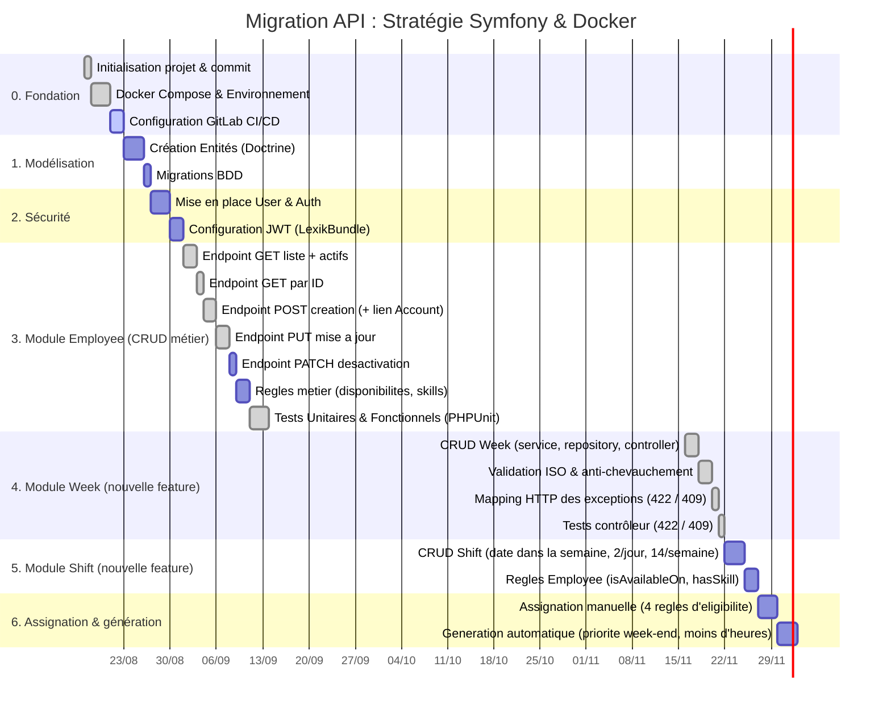

# Plan de Migration et Gestion de Projet : API TypeScript vers Symfony

Ce document détaille le planning et la méthodologie suivis pour la refonte de l'API [gensceduleback](https://gitlab.com/remyHamed/gensceduleback), initialement écrite en TypeScript, vers une architecture Symfony (PHP).

> **Périmètre** : ce planning couvre la migration à parité de fonctionnalités avec l'API TypeScript existante (Auth + module Employee). L'ajout de nouvelles features ou de nouvelles routes/CRUD fait l'objet d'itérations et d'issues ultérieures, hors du scope de la parité (voir Phases 4 à 6 : modules `Week`, `Shift`, assignation et génération du planning).

## 1. Diagramme de Gantt (Planning prévisionnel)

## 2. Roadmap et Découpage des Tâches

Chaque étape ci-dessous correspond à une branche ou une issue sur ce dépôt.

### Phase 0 : Infrastructure (Fondations)

- [x] Initialisation du projet Symfony et premier commit sur GitLab.
- [x] Dockerisation : mise en place de php-fpm, nginx, postgresql via docker-compose (Dockerfile multi-stage dev/prod, healthchecks, séparation des secrets).
- [X] CI/CD : configuration du `.gitlab-ci.yml` pour le linting et les tests automatiques.

### Phase 1 : Modélisation (ORM)

- [X] Entités : utilisation de `make:entity` pour reproduire le modèle de données de l'API TS.
  - Note : le champ sera nommé `availableSlots` (nom retenu suite à un renommage en cours dans la source TS, non finalisé).
- [X] Migrations : génération et exécution des fichiers de migration Doctrine.

### Phase 2 : Sécurité & Authentification

- [x] UserProvider : configuration de l'entité `User` (`Account`) pour l'auth Symfony.
- [x] JWT : installation et configuration de `lexik/jwt-authentication-bundle` pour sécuriser les endpoints.
- [x] Endpoints `register` / `login` (portage direct de `AuthController` / `AuthService`).

> **Note de périmètre** : l'API source ne définit aucun CRUD complet pour `Account` (pas de liste, mise à jour, ni suppression — uniquement `register`, `login` et les lookups internes par `id`/`email`). Ce planning ne couvre donc que l'authentification ; un CRUD `Account` complet serait une nouvelle feature, hors scope ici.

### Phase 3 : Implémentation Métier — Module `Employee`

Reprend fidèlement les endpoints exposés par `EmployeeController` / `employeeRoutes.js` dans l'API TypeScript source.

- [x] `GET /employees` : liste complète des employés.
- [x] `GET /employees/active` : liste filtrée sur `isActive = true`.
- [x] `GET /employees/{id}` : détail d'un employé (404 si absent).
- [x] `POST /employees` : création, avec liaison obligatoire à un `Account` existant (`accountId`) et vérification qu'un `Account` n'est pas déjà lié à un employé.
- [x] `PUT /employees/{id}` : mise à jour partielle (nom, `weeklyHours`, `joursDisponibles`, `datesExclues`, `skills`).
- [ ] `PATCH /employees/{id}/deactivate` : désactivation (soft delete via `isActive`).
- [ ] Portage des enums `Role` (ADMIN, EMPLOYEE, MANAGER) et `DayOfWeek` (0-6) en PHP (enums natifs Symfony 8+).
- [ ] Règles métier : disponibilité d'un employé sur une date donnée (`joursDisponibles` + `datesExclues`), et matching par `skills`.
- [x] `DELETE /employees/{id}` : suppression définitive (ajout hors parité TS, `EmployeeInUseException` si l'employé est référencé).
- [x] Tests PHPUnit : un test par endpoint + cas d'erreur (compte introuvable, compte déjà lié, employé introuvable).

### Phase 4 : Module `Week` (nouvelle feature, hors parité TS)

Règles métier retenues : une semaine dure 7 jours, `startDate` est le lundi ISO-8601 de `(year, weekNumber)`, un seul établissement et une seule équipe pour l'instant.

- [x] CRUD `Week` : `GET /api/weeks`, `GET /api/weeks/{id}`, `POST`, `PUT`, `DELETE`.
- [x] Unicité du couple `(year, weekNumber)` (create et update, en excluant l'id courant sur update).
- [x] Validation de la période : format `Y-m-d`, `startDate` = lundi, `weekNumber` entre 1 et 53, semaine existante cette année-là, cohérence `year` / `weekNumber` / `startDate`.
- [x] Interdiction de chevauchement (`WeekRepository::overlapsPeriod`), les semaines collées (S48 puis S49) restent autorisées.
- [x] Exceptions métier : `InvalidWeekPeriodException` (422), `WeekOverlapException` (409), `WeekAlreadyExistsException` (409).
- [x] Tests unitaires du service (`WeekServiceTest`, 13 tests).
- [x] Tests contrôleur : `startDate` non lundi → 422, chevauchement → 409.
- [ ] Règles à trancher : modification de `startDate` d'une `Week` ayant déjà des `Shift`, suppression d'une `Week` avec `Shift` (cascade ou blocage). Traité avec la Phase 5.

### Phase 5 : Module `Shift` (nouvelle feature, hors parité TS)

Règles métier : un `Shift` est rattaché à une `Week` (date comprise entre `startDate` et `startDate + 6 jours`), `endTime` strictement après `startTime`, 2 shifts max par jour, 14 max par `Week`. Remplacement du `ShiftController` Twig actuel par une API JSON.

- [ ] Tests `GET /api/shifts` (liste complète et par semaine) + cas d'erreur.
- [ ] Implémentation `GET /api/shifts`.
- [ ] Tests `GET /api/shifts/{id}` (200 / 404).
- [ ] Implémentation `GET /api/shifts/{id}`.
- [ ] Tests `POST /api/shifts` (création + validations période, horaires, quotas 2/jour et 14/semaine).
- [ ] Implémentation `POST /api/shifts`.
- [ ] Tests `PUT /api/shifts/{id}` (mise à jour + revalidation des règles).
- [ ] Implémentation `PUT /api/shifts/{id}`.
- [ ] Tests `DELETE /api/shifts/{id}` (204 / 404).
- [ ] Implémentation `DELETE /api/shifts/{id}`.
- [ ] Tests & gestion de l'impact `Week` / `Shift` (modification de `startDate` ou suppression d'une `Week` contenant des shifts).

### Phase 6 : Assignation et génération du planning

Portage de `ScheduleService` et `ScheduleGenerationService`. Prérequis : `isAvailableOn` et `hasSkill` (Phase 3). Règles d'éligibilité (compétence, disponibilité midi/soir, plafond `weeklyHours`, non-doublon sur le shift), suivi des heures déjà assignées, et priorité week-end + moins d'heures (`LeastHoursFirstStrategy`) sur une `Week` existante.

- [ ] Tests unitaires des règles d'éligibilité (1 classe par règle) et du compteur d'heures (`AssignedHoursTracker`).
- [ ] Implémentation des règles d'éligibilité et du suivi des heures.
- [ ] Tests `POST /api/shifts/{id}/assign` (assignation manuelle + refus si règle violée).
- [ ] Implémentation `POST /api/shifts/{id}/assign`.
- [ ] Tests `DELETE /api/shifts/{id}/assign/{employeeId}` (désassignation).
- [ ] Implémentation `DELETE /api/shifts/{id}/assign/{employeeId}`.
- [ ] Tests `POST /api/weeks/{id}/generate` (génération automatique du planning de la semaine).
- [ ] Implémentation `POST /api/weeks/{id}/generate`.

## 3. Definition of Done

Une tâche n'est considérée comme terminée que si les 4 critères suivants sont remplis (applicable à chaque endpoint de la Phase 3, et de toute phase ultérieure) :

1. Code implémenté et respectant l'architecture du projet (Controller / Service / Repository).
2. Test unitaire sur la logique métier (Service).
3. Test fonctionnel/intégration sur l'endpoint (Controller + BDD).
4. Merge Request revue (auto-relecture) et liée à son issue GitLab (`Closes #<numéro>`).

## 4. Notes de méthodologie

- Une issue GitLab est créée pour chaque tâche listée ci-dessus.
- Les commits utilisent `Closes #<numéro>` pour fermer automatiquement l'issue liée.
- Le frontend Angular fait l'objet d'un projet séparé et n'est pas inclus dans ce planning.